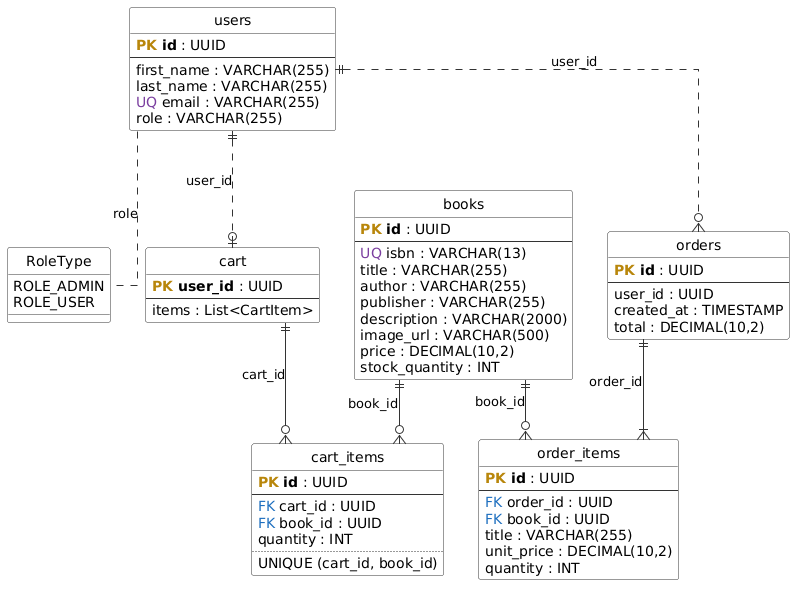

# SYSC 4806 Project 
## "Amazin online bookstore"

### Azure deployment link
https://4806bookstore-g4axbnebhdf5h5da.canadacentral-01.azurewebsites.net/

## Project Structure
```bash
src/main/
   - java/                  # Program Root
      .../sysc4806project/  # Spring Code
         - controller/      # REST Endpoints 
         - dto/             # Data Transfer Objects (FE <-> BE)
         - exception/       # REST Exception handler
         - model/           # ORM Entity mappings
         - repository/      # ORM Repos Interfaces (to talk to db)
         - service/         # Application Logic
   - resources/             # Program Setup
     - db/                  # Database Seed
     - static/              # Thymeleaf JS/CSS files
     - templates/           # Thymeleaf HTML templates
     - application.yml      # Spring Boot configuration
mvnw                        # Maven Runtime
```

## Running the project
Clone the repository
```bash
git clone git@github.com:TASelwyn/SYSC4806_Project.git
```

Enter the project folder
```bash
cd SYSC4806_Project
```

Build & Run the application
```bash
./mvnw spring-boot:run
```


## Project Status
Summary of the [Kanban board](https://github.com/users/TASelwyn/projects) as of 2026-11-26.

### Todo
| Issue | Task                 | Assignee      |
|-------|----------------------|---------------|
| #50   | Recommended Books    | initishgrover |
| #51   | Recommended Books UI | Kemal-Sogut   |
| #52   | Admin page           | TASelwyn      |
| #54   | Admin page UI        | CamGreer      |
| #56   | Orders UI            | SamTouma8     |

### In Progress
Nothing currently in progress.

### Done
(Sorted by issue ID, not completion milestone or workload)

| Issue | Task                                                     | Assignee      | PR  |
|-------|----------------------------------------------------------|---------------|-----|
| #1    | Add initial Spring setup                                 | TASelwyn      | #2  |
| #3    | Add Maven CI                                             | TASelwyn      | #4  |
| #5    | Implement Book JPA entity                                | SamTouma8     | #11 |
| #6    | Configure H2 database                                    | SamTouma8     | #12 |
| #7    | Implement BookRepository                                 | SamTouma8     | #16 |
| #8    | Populate sample book data                                | SamTouma8     | #17 |
| #9    | Write repository and integration tests                   | SamTouma8     | #26 |
| #10   | Document Database Schema                                 | TASelwyn      | #47 |
| #13   | Azure deployment                                         | TASelwyn      | N/A |
| #14   | Shopping cart logic                                      | TASelwyn      | #35 |
| #15   | Checkout controllers/logic                               | Kemal-Sogut   | #41 |
| #18   | Create Thymeleaf pages                                   | Kemal-Sogut   | #21 |
| #22   | Book controller: list, search and detail endpoints       | initishgrover | #23 |
| #29   | Database seeding and book retrieval across environments  | SamTouma8     | #17 |
| #38   | User Toggle                                              | initishgrover | #39 |
| #40   | Update documentation                                     | TASelwyn      | #47 |
| #45   | Order Confirmation and Thank You Page                    | SamTouma8     | #46 |
| #48   | Shopping cart UI                                         | CamGreer      | #42 |
| #49   | Book Catalog Service                                     | CamGreer      | #24 |

## Authors
- Thomas Selwyn (101183163)
- Kemal Sogut (101280677)
- Sam Touma (101033509)
- Cameron Greer (101309871)
- Nitish Grover (101324174)


### Database Schema



Generated using [PlantUML](https://www.plantuml.com/plantuml/uml/), Source: [`docs/database.puml`](docs/database.puml)

### Database Seeding

The application uses an H2 database to store book information.

Sample data is provided in:
`src/main/resources/db/seed-books.sql`

The seed script contains 10 books with:
- Unique 13-digit ISBNs without hyphens
- Titles, authors, and publishers
- Descriptions and cover image URLs
- Different inventory quantities, including an out-of-stock book

The in-memory H2 database resets when the application stops.
Sample books are automatically reloaded on the next startup.

When running the project locally, the database can be inspected at:
http://localhost:8080/h2-console

## License
This project is for academic use only (course submission). No warranty. Not for commercial distribution.
